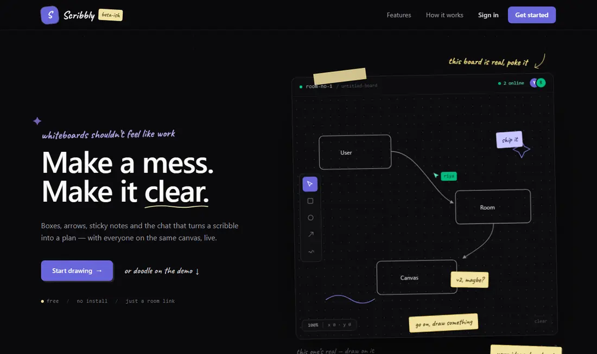
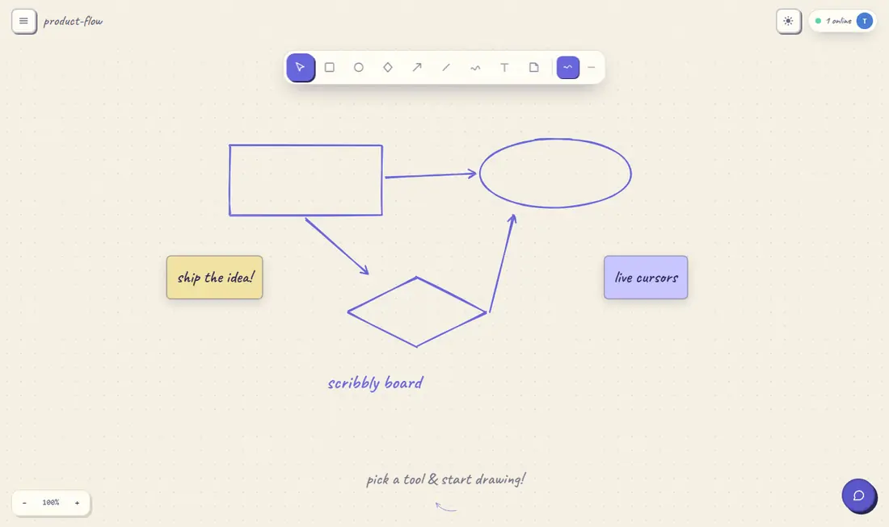

# Scribbly — sketch together

A collaborative, hand-drawn whiteboard inspired by Excalidraw: boxes, arrows, freehand
doodles, sticky notes, live cursors and per-room chat — all shared in real time on one canvas.

> **Live demo:** [scribbly-board.vercel.app](https://scribbly-board.vercel.app/)

## Screenshots




## Features

- **Auth** — sign up / sign in with an httpOnly JWT cookie; protected rooms.
- **Rooms** — create or join a board by slug URL; copy an invite link to the lobby.
- **Canvas tools** — Select, Rectangle, Ellipse, Diamond, Arrow, Line, freehand Draw,
  Text and Sticky note (yellow / violet / green).
- **Hand-drawn feel** — Rough.js strokes with a rough/solid toggle.
- **Editing** — select and move shapes; double-click with Select to edit a note or drop a
  text box anywhere else on the board.
- **Camera** — zoom and pan with on-screen zoom controls.
- **Real time** — shapes, cursors and presence sync instantly over WebSockets.
- **Chat** — a per-room chat popup with persisted history.
- **Persistence** — rooms, shapes and messages are stored in Postgres (Prisma 7), so a
  reload restores the board.

## Stack

| Layer      | Tech                                                                         |
| ---------- | ---------------------------------------------------------------------------- |
| Frontend   | Next.js 16 (App Router), React 19, Tailwind CSS 4, Rough.js, framer-motion    |
| HTTP API   | Express 5, bcrypt, jsonwebtoken (httpOnly cookie), zod validation             |
| Realtime   | `ws` WebSocket server, JWT-cookie verification on the handshake               |
| Database   | PostgreSQL (Neon) via Prisma 7 + `@prisma/adapter-pg`                         |
| Monorepo   | pnpm workspaces + Turborepo, TypeScript everywhere                            |

## Architecture

```
Browser (Next.js :3000)
  │
  ├─ REST ──▶ http-backend :3001 ──▶ PostgreSQL
  │            auth · rooms · chat history          (Prisma 7)
  │
  └─ WS  ──▶ ws-backend :8080
               verifies the JWT cookie ──▶ fans out to everyone in the room
               (shape ops, cursors, chat)
```

Database writes happen before a message is broadcast, so anything two people see is
already persisted. The canvas itself is split into a framework-free drawing engine
(`app/components/draw/index.ts`: rendering, camera, hit-testing, text layout) and a thin
React host (`Canvas.tsx`: input, the text overlay, tool state).

## Repo layout

```
apps/
  scribbly-frontend/     Next.js UI + canvas engine            (:3000)
  http-backend/          Express API for auth, rooms, chat    (:3001)
  ws-backend/            WebSocket fan-out per room           (:8080)
packages/
  db-package/            Prisma schema, migrations, seed
  backend-config/        env loading + JWT secret fail-fast
  zod-config/            shared validation schemas
  ui/                    shared UI components
  typescript-config/     shared tsconfigs
  eslint-config/         shared lint config
```

## Getting started

**Prereqs:** Node 24+, pnpm 11 and a PostgreSQL database (Neon or local).

1. Install dependencies:

   ```bash
   pnpm install
   ```

2. Create the env files from the templates and fill in the real values:

   ```bash
   cp packages/db-package/.env.example packages/db-package/.env
   cp apps/http-backend/.env.example apps/http-backend/.env
   cp apps/ws-backend/.env.example apps/ws-backend/.env
   cp apps/scribbly-frontend/.env.example apps/scribbly-frontend/.env.local
   ```

   - The **same** `DATABASE_URL` goes in `packages/db-package`, `apps/http-backend` and
     `apps/ws-backend` (use the pooled Neon connection string).
   - The **same** `JWT_SECRET` goes in `apps/http-backend` and `apps/ws-backend` — tokens
     signed by the API are verified on the WebSocket handshake.
   - The frontend defaults (`http://localhost:3001`, `ws://localhost:8080`) already match
     the local backend ports.

3. Apply migrations and seed the database (run from `packages/db-package`):

   ```bash
   cd packages/db-package
   pnpm exec prisma migrate deploy   # apply the committed migrations
   pnpm exec prisma db seed          # demo user, empty room list
   ```

   While changing the schema use `pnpm exec prisma migrate dev`. To wipe everything and
   start over: `pnpm exec prisma migrate reset --force && pnpm exec prisma db seed`
   (the seed clears rooms and chats too).

4. Start all three apps from the repo root:

   ```bash
   pnpm dev
   ```

5. Open <http://localhost:3000>, sign up, or use the seeded demo account:

   ```
   email:    testuser1@example.com
   password: Testuser@1
   ```

## Environment variables

| App                             | Variable                                        | Required | Notes                                                    |
| ------------------------------- | ----------------------------------------------- | -------- | -------------------------------------------------------- |
| `packages/db-package`           | `DATABASE_URL`                                  | yes      | Postgres URL (pooled); used by the Prisma CLI and client |
| `apps/http-backend`             | `JWT_SECRET`                                    | yes      | Long random string; must match `ws-backend`              |
|                                 | `DATABASE_URL`                                  | yes      | Same value as `db-package`                               |
|                                 | `PORT`                                          | no       | Default `3001`; hosts usually inject it                  |
|                                 | `FRONTEND_ORIGIN`                               | no       | Comma-separated CORS origins; default `http://localhost:3000` |
|                                 | `NODE_ENV`                                      | no       | `production` makes the session cookie HTTPS-only         |
| `apps/ws-backend`               | `JWT_SECRET`                                    | yes      | Must be identical to `http-backend`                      |
|                                 | `DATABASE_URL`                                  | yes      | Same value as `db-package`                               |
|                                 | `PORT`                                          | no       | Default `8080`; hosts usually inject it                  |
| `apps/scribbly-frontend`      | `NEXT_PUBLIC_BACKEND_URL`                       | yes      | Public URL of the HTTP API (baked in at build time)      |
|                                 | `NEXT_PUBLIC_WS_URL`                            | yes      | `ws://` locally, `wss://` in production                  |

## Scripts

Run from the repo root (Turborepo fans them out):

| Command              | What it does                             |
| -------------------- | ---------------------------------------- |
| `pnpm dev`           | Start frontend, HTTP API and WS server   |
| `pnpm build`         | Build every app and package              |
| `pnpm lint`          | Lint every workspace                     |
| `pnpm check-types`   | Type-check every workspace               |

## Deployment notes

- **Frontend (Vercel):** set `NEXT_PUBLIC_BACKEND_URL` and `NEXT_PUBLIC_WS_URL` to the
  deployed backend URLs before building (they are compiled into the bundle). Use `wss://`
  behind HTTPS.
- **HTTP backend (Render / Railway / Fly):** set `JWT_SECRET`, `DATABASE_URL`,
  `FRONTEND_ORIGIN` (the exact deployed frontend origin; comma-separate multiples) and
  `NODE_ENV=production`. The port comes from the host.
- **WS backend:** set the same `JWT_SECRET` and `DATABASE_URL`; the host injects `PORT`.
  Terminate TLS in front of it so the frontend can connect with `wss://`.
- **Database (Neon):** run `pnpm exec prisma migrate deploy` against the production
  database. Run `db seed` only if you want the demo account there.

## Roadmap

The next planned feature is a small AI panel where a prompt ("draw a login flow with
three boxes") is turned into validated shape JSON and drawn through the existing shape
path. Everything else above is what ships today.
